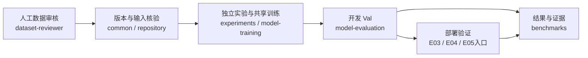

# SoccerVision-Lab

面向机器人双目足球感知的研究与实验仓库：在小球、遮挡、模糊和无球场景中，研究**检测质量、误报代价与边缘端实时性之间的取舍**。工作覆盖数据审核、YOLO26 单类别微调、结构缩窄、知识蒸馏，以及 Jetson Orin NX 上的 TensorRT 推理链路验证。

**技术阅读入口：** [研究证据路线与 CPU 合成评估演示](docs/TECHNICAL_READING.md)

**阅读入口：** [实验路线 E00–E08](experiments/README.md) · [结果与比较口径](benchmarks/RESULTS.md) · [复现与产物定位](docs/REPRODUCIBILITY.md) · [来源核对与证据缺口](docs/SOURCE_AUDIT.md)

**数据审核工作入口：** [审核操作与版本选择](docs/DATA_WORKFLOW.md) · [Qt 审核工具](script/dataset-reviewer/README.md) · [操作手册](script/dataset-reviewer/docs/user-guide.md)

## 研究问题与方法

- **检测质量：** 单类别微调能否改善原模型的足球漏检？nano 模型在小球和遮挡场景损失多少召回，蒸馏能恢复多少，又增加多少无球误报？
- **硬件效率：** 理论参数减少是否能转化为实际 TensorRT 加速？先用逐层 Profiling 和 Nsight 定位成本，再验证结果回传、CUDA Graph 和预处理的改动。
- **实验归因：** 区分模型结构、初始化、额外训练、工作阈值及功耗模式。E08 专门补齐 E07 WarmKD 的同起点无蒸馏继续训练对照，目前只有实现与工程验证，**正式训练和新指标为 `not_run`**。

检测侧以 YOLO26s / YOLO26n 为基础，目标类别为 `0=football`；训练保留双检测分支，独立评估与部署使用 one-to-many 输出加外部 NMS。E06/E07 用冻结的 E01-s 教师做 P3/P4/P5 特征蒸馏，最终保存普通 nano 学生。机器人链路以 ZED Mini 左右目组成 batch2，经检测、双目匹配、三维定位与跟踪后发布 ROS 消息。[方法依据](experiments/E06_distillation/README.md) · [部署链路及边界](experiments/E04_tensorrt_pipeline/REPORT.md)

## 实际工作流程



这是已有工具之间的关系，不是自动执行流水线，也不表示每个模型都已走完部署验证。训练与评估复用共享实现，各实验负责来源核验、独立 run 和有效配置记录；部署验证与训练在不同设备上进行。[工具总览](script/README.md) · [复现前提与命令](docs/REPRODUCIBILITY.md)

## 数据概况

当前共享配置选择 `datasets/v1`。数据来自机器人视角录像与 legacy 样本，单类足球框之外另有 `Small`、`Occluded`、`Blurred`、`No Ball` 图级标记，场景可重叠。它们不是 COCO 面积分层，也不是每个框都具有独立困难属性。[数据定义](script/dataset-reviewer/docs/data-format.md)

|版本|角色|Train|Val|Test|来源|
|---|---|---:|---:|---:|---|
|v0|审核资料与历史来源划分|6925|1223|0|[版本索引](datasets/VERSION_INDEX.md)|
|v1|冻结实验版本|4346|1223|464|[分集报告](datasets/v1/REPORT.md)|

v1 另保留 buffer755、heldout_unused1360；250张排除样本保留在 v0。Val 含855个球框及410张确认无球图。Test是**同场次片段留出**，与Train共享采集场次，不能称为独立场次泛化测试。来源报告还明确记录了时间相关性、旧权重曝光史和再分发范围的限制。[版本与数据边界](datasets/v1/README.md) · [具体旧权重的维护者确认](reports/workspace-organization/OWNER_ASSERTIONS.md)

本页模型成绩均为开发 **Val**，没有将数据加载校验或模型现场观察写成 Test 成绩。冻结数据和历史证据不随文档整理改写；新增标注修订应建立新版本。

## 实验路线与已有结论

|路线|研究推进|已经支持的结论|仍未解决的问题|
|---|---|---|---|
|E00 → E01|原模型参考 → 足球单类微调|开发Val的AP和召回改善，低阈值误报增加|类别变化与训练共同发生；不是单一类别数消融|
|E01 → E02 → E03|指定层缩窄 → 实机瓶颈诊断|当前L19缩窄未取得可测量加速，局部执行反而更慢|原结构继续训练control无结果；参数量不能替代延迟|
|E03 → E04|A2结果合并回传、CUDA Graph、预处理试验|固定有球同期对照支持A2+Graph收益；保留预处理负结果|接入安装不等于生产性能、长稳或物理定位验收|
|E05 / E06 / E07 / E08|E05同init→E06；E05 best→E07 / E08的KD与NoKD对照|召回、AP和误报存在取舍|E08尚未正式训练，WarmKD的额外训练效应未分离|

逐项假设、状态与证据见 [完整实验导航](experiments/README.md)。以下只展示两组互不混算的结果：

- **模型质量，v1 Val、conf=0.45：** E05的AP50–95为76.846%，E07为77.540%；无球误报从4/410变为7/410。E06的Small Recall为92.340%，同时无球误报为25/410。它们是单seed开发结果，不能据此声称KD净收益或全面优于教师。[E07统一报告](experiments/E07_warmstart_distillation/REPORT.md)
- **系统性能，E04 phase5、Orin NX 16GB、25W/408MHz上限：** 同期有球R0/R4为14.580/15.590帧对每秒，三轮配对宏平均提升6.928%。这不是纯Engine耗时，也不与其他现场或MAXN消息频率拼接。[性能报告](experiments/E04_tensorrt_pipeline/PERFORMANCE_COMPARISON.md)

E04后续记录显示E01+A2+Graph已接入并安装；该次接入未启动生产感知或补做GPU性能/长稳验收。综合阶段报告中的nano现场频率观察缺少完整绑定证据，单列于 [证据缺口](docs/SOURCE_AUDIT.md#待补齐的证据)，不进入正式性能排名。

## 从哪里开始复现

仅阅读上述 Markdown 报告不需要 GPU、Qt 或本地 run。若要执行工具，先查 [环境、权重与本地产物要求](docs/REPRODUCIBILITY.md)；历史训练使用固定版本，通用工具的安装说明不能替代原 run 的库源码哈希。

从仓库根目录，用已具备 PyYAML 的 Python 查看配置与E08设计，不启动训练或读取图片：

```bash
python script/common/dataset_config.py
python experiments/E08_warmstart_no_distillation/e08.py dry-run
```

随后按用途进入：

|目的|入口|
|---|---|
|审核新增数据、查历史分组和快捷键|[数据审核工作流](docs/DATA_WORKFLOW.md)|
|复现实验训练、smoke或恢复|[实验索引](experiments/README.md)中的对应入口；E08完整命令在其[README](experiments/E08_warmstart_no_distillation/README.md)|
|独立Val、工作阈值与场景指标|[共享评估工具](script/model-evaluation/README.md)|
|了解实机测量边界与原始证据|[E03结果索引](experiments/E03_tensorrt_profiling/results/README.md)、[E04复算说明](experiments/E04_tensorrt_pipeline/REPRODUCE.md)|
|审查结果来源、缺失项和本地run|[来源核对清单](docs/SOURCE_AUDIT.md)、[产物引用](docs/REPRODUCIBILITY.md#公开摘要与本地产物)|

## 仓库结构与可追溯性

|目录|内容|
|---|---|
|`experiments/`|E00–E08的计划、编排入口、报告与验证记录；独立run默认忽略|
|`benchmarks/`|按口径分组的结果摘要、历史E00–E03表格；不是所有实验共用的一张排行榜|
|`datasets/`、`dataset_processing/`|版本说明、冻结数据依据、审核/审计阶段链|
|`script/`|人工审核、共享训练/评估、数据配置与校验、实验审计辅助|
|`baseline/`、`models_list/`|历史参考模型与发布的模型资产；以报告中的SHA核对身份|
|`docs/`、`reports/`|项目导览、复现约束、阶段总结和历史整理依据|

网页链接指向已跟踪文件；只在工作站存在的 run、日志和恢复包标为“本地产物引用”。克隆仓库不等于取得所有运行证据。仓库尚未声明统一开源许可证，数据、录像和参考权重的来源授权需分别核对；存在文件不等于允许再分发。[审核工具交付说明](script/dataset-reviewer/README.md) · [参考资产说明](baseline/README.md)
