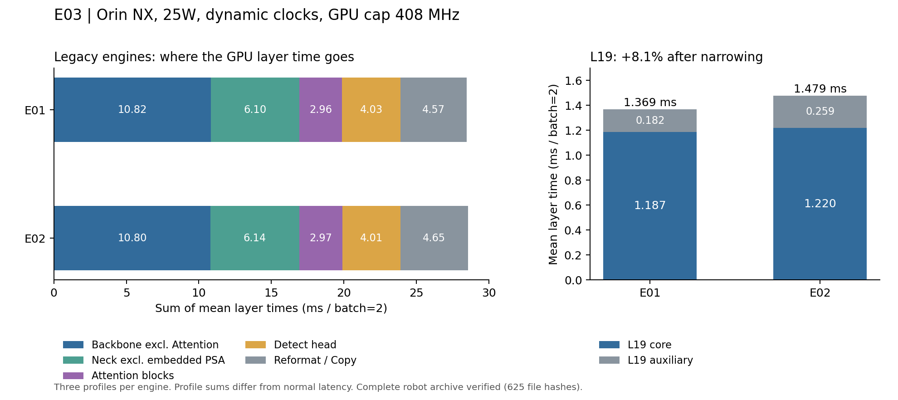

# E03：YOLO26s TensorRT 逐层性能剖析与瓶颈定位

**状态：E03 已完成。机器人原始结果已完整回收，通过归档包及 625 个文件的 SHA256 校验，并完成本机 CPU 重算与报告核对。**

运行 ID：`20261021T080741Z_824b47`，日期：2026-10-21。构建、正确性、正常测速、逐层 profile、Nsight 与现场系统锚点均在机器人完成。机器人电量耗尽曾中断回收；重新开机后只进行了文件回收，没有重建或重测。断线前记录的 118 项数值与完整原始分析核对通过。

## 1. 已获得的结论

1. **E02 没有获得 Engine 加速。** 原有 Engine 三轮复测，E01 为 **28.135 ms/batch2**，E02 为 **28.275 ms**；新构建 performance 对照为 28.178 / 28.222 ms。新组差异只有 0.044 ms，低于 E01 逐轮变化的约 0.12 ms 量级。
2. **缩窄 L19 后，该模块的实际 TensorRT 执行合计反而变慢。** 直接剖析原有 Engine，L19 从 1.369 ms 增至 1.479 ms，增加 **8.10%**。新增成本约 70.2% 来自归属于该层的辅助执行增长。它在 E01 中仅占 profile 总时间的 **4.80%**，继续盲搜宽度缺乏依据。
3. **主要 GPU 成本分布在 Backbone、Neck 与执行辅助层。** Attention 块合计约 10.4%，其中层名可识别的 MatMul/Softmax 约 5.3%。本次结果不支持把 Attention 认定为整网第一瓶颈。
4. **系统提交、预处理和后处理值得优先做 E04。** 已确认安装环境使用纯 PyTorch NMS 回退；固定输入的检测器 trace 中，目标应用无 GPU 活动的间隔占窗口约 54.5%。CUDA Graph 单轮诊断降低 GPU Compute 约 7.47%、enqueue 墙钟约 96.3%，但尚未接入生产路径或证明系统 Hz 提升。
5. **当前完整系统仍约 16.8 Hz。** 新增单轮实机系统锚点为 16.812 Hz、整循环均值 59.302 ms。尚未达到 30/50 Hz。所有结果均对应机器人测量时的 **25W、GPU 上限 408 MHz、动态时钟** 条件。

## 2. 环境、模型与隔离

| 项目 | 实测条件 |
|---|---|
| 设备 | Orin NX Developer Kit，16 GB 统一内存，aarch64 |
| 软件 | JetPack 5.1.5、L4T R35.6.0、CUDA Runtime 11.4.298 |
| TensorRT | Debian 包 8.5.2；Python API 8.5.2.2 |
| 部署环境 | Python 3.8.20，Torch 2.0.0+nv23.05；加载现有部署 runtime |
| Nsight Systems | 2024.5.4 |
| 功耗与频率 | 25W，ID=3；配置文件明确限制 GPU 408 MHz；min 306 MHz，未锁频 |
| CPU / EMC | CPU schedutil、最高约 1497.6 MHz；EMC 动态频率，未开启 override |
| 输入 / 输出 | FP32 `[2,3,640,640]` / FP32 `[2,5,8400]`；固定 batch2 |
| 导出图 | 复用原有 opset17 ONNX；原始 one-to-many 输出，外部 NMS；没有重新导出 |
| 新构建组 | FP16 tactics、FP32 CHW I/O、workspace 2048 MiB；逐层精度以 detailed Inspector 为准 |
| 其他负载 | 保留机器人原有控制/ROS 后台任务；未自行终止控制进程 |

`tegrastats` 的 GPU 利用率有效：A 阶段 467 条记录中 416 条非零，最高 99%；其 GPU 频率字段持续为 0，该字段不用于推断频率。B 阶段起另采 sysfs GPU 频率/load。不能把零频率字段解读为 GPU 没有执行。

构建、正确性、所有性能测量与 Nsight 采集都在机器人上执行。本机只准备固定输入、分析文件并生成摘要。原有源码及安装位置的 12 项模型文件/链接在开始与结束核对，均未改变；未调整功耗、时钟或生产配置。最后已停止本实验自己的采集/监控进程，测试 Viser 端口关闭。未训练，未访问 Test，未提交或推送。

原有 Engine SHA256：

```text
E01 98c1b6bc703b29874d95db94d9cf51ef5b4a4142a7ca6cf22362a0c616fbf348
E02 62e0cd2e4fb9798dced6c47e1805cc0b20be6b8006d289b02de624d88c399b12
```

## 3. 正常推理计时：A～C 检查点

GPU 常驻 seed42 固定随机输入，CUDA events 包围 TensorRT 执行，每次同步；100 次预热，每模型三轮、每轮 60 秒、交错执行。正常计时不挂 layer profiler 或 Nsight。

| Engine | 模型 | mean ms/batch2 | P50 | P95 | P99 |
|---|---|---:|---:|---:|---:|
| 原有 | E01 | 28.13498 | 28.13542 | 28.17087 | 28.18651 |
| 原有 | E02 | 28.27537 | 28.28502 | 28.33907 | 28.35631 |
| 新 performance | E01 | 28.17795 | 28.15422 | 28.27449 | 28.29213 |
| 新 performance | E02 | 28.22171 | 28.22074 | 28.26188 | 28.27808 |

原有 E01/E02 分别为 6250 / 6225 次。E01 三轮均值为 28.13806、28.13666、28.13019 ms；E02 为 28.29033、28.22202、28.31396 ms。E02 三轮均未更快，合并差异为 +0.14039 ms（+0.499%）。不把这组结果推广为跨设备的统计显著性结论。

原有组同步 execute 墙钟均值为 E01 28.67667 / E02 28.79778 ms；该边界含主机提交和等待，与 CUDA event 范围不同。

新 performance 的 E02 比 E01 多 0.04377 ms（+0.155%），无法支撑加速结论；样本数分别 6246 / 6235。其逐轮均值如下，第二轮的相对方向反转也说明合并的小差异不宜解释为稳定结构收益。

| 新 performance | 第 1 轮 mean ms | 第 2 轮 | 第 3 轮 |
|---|---:|---:|---:|
| E01 | 28.14803 | 28.25390 | 28.13218 |
| E02 | 28.21162 | 28.21387 | 28.23965 |

详细 profile Engine 各做一轮 60 秒正常校核，E01 mean/P50/P95/P99 为 28.17335 / 28.17226 / 28.20658 / 28.22113 ms（2084 次）；E02 为 28.28340 / 28.28328 / 28.31761 / 28.33039 ms（2074 次）。只用作诊断校核，不替代三轮主对照。完整逐轮 Engine/event 与 execute 墙钟数据见 [正常计时 CSV](results/normal_timings.csv)。

因此未开展通道数搜索；继续逐层对照与定点系统分析。

### 新旧 Engine 的可比范围

四份新 Engine 构建与一致性检查完成。E01 performance 构建约 1378 秒；详细版复用该组 timing cache，约 82 秒。尽管缓存相关，E01 performance 与 detailed 的层定义分别为 222 / 224，详细版新增关联 L10、L22 的两处 Reformat，**不能视为完全相同的执行图**。旧构建的实际 workspace 上限也无法仅据历史 YAML 注释确定。

层定义/已采集行数如下；其中可能包含零耗时或消除的辅助层，层数不等于 kernel 数。

| 模型 | 原有 Engine | 新 performance | 新 detailed |
|---|---:|---:|---:|
| E01 | 233 | 222 | 224 |
| E02 | 231 | 232 | 230 |

为避免重建差异被误用，本报告的主要模块表和 L19 结论来自原有 Engine 序列化内容的直接 profile；新 detailed 版另行提供 tensor、格式与 tactic 诊断。新组结果只作交叉验证。完整命令、Engine hash、大小与构建时间见 [构建清单](results/build_inventory.json)。

原有与 performance Engine 均只有 `layer_names_only`，无法恢复其内部完整 tensor shape/dtype/tactic。不能把新 detailed 的内部信息填成旧 Engine 的真实信息。

### 正确性

固定 64 张 Val 图片，按 seed42 选取 Small、Occluded、Blurred、No Ball 各 16 张不重复图片，并保留样本、图像及标签 hash。多标签存在重叠。比较各模型原有 Engine 与对应 performance/detailed 两候选，共四项，全部通过预先冻结的阈值。

| 模型 | 参考 / 候选检测数 | 检测数量变化或未匹配 | 匹配框最大坐标差 | 匹配分数最大差 |
|---|---:|---:|---:|---:|
| E01，两候选 | 43 / 43 | 0 | 0.125 px | 0 |
| E02，两候选 | 44 / 44 | 0 | 0 px | 0.0002412 |

阈值为匹配 IoU≥0.9、最大坐标差≤2 px、分数差≤0.03；后处理统一 conf=0.45、IoU=0.7、max_det=300。原始输出也比较了有限值与误差：E01 原始坐标张量最大绝对差 1.0、坐标差 P99 为 0.25，匹配保留框最大坐标差 0.125 px；E02 原始输出最大差约 0.0002431。完整结果见 [正确性报告](results/correctness_summary.json)。此项是固定 Val 子集的导出一致性，不是全量 AP，也不是部署候选验收。

## 4. 模块耗时与 E04 优先级

下表来自**原有 E01/E02 Engine 各三次独立 profile 的逐层均值汇总**，单位 ms/batch2。逐层采集使用真实预处理的代表性 batch2 常驻输入、无显式传输，2 秒预热、10 秒采集、至少 200 次，使用 separateProfileRun。分母为各自 layer profile 合计 E01 28.48785 / E02 28.56701 ms，包含 profiler 测量影响，不能直接当作 28.135 ms 正常计时的精确分解。

| 模块 | E01 ms | E01 占比 | E02 ms | 优化证据与建议 |
|---|---:|---:|---:|---|
| Backbone，扣除 Attention | 10.823 | 37.99% | 10.797 | GPU 最大成本组；结构 E04 候选，先审阅高分辨率 Conv/C3k2 的实际层明细 |
| Neck，扣除内嵌 PSA | 6.099 | 21.41% | 6.137 | 结合上采样后 Copy、高分辨率融合与实际布局分析，结构 E04 候选 |
| Attention 块 | 2.961 | 10.39% | 2.966 | 非整网第一成本；不优先盲目删除或缩窄 |
| Detect Head | 4.032 | 14.15% | 4.014 | 保留为次级结构候选；它不包括 Engine 外部 NMS |
| Reformat / Copy 等执行辅助 | 4.573 | 16.05% | 4.652 | 显著，尤其 L19；优先研究布局/复制来源，尚未证明带宽瓶颈 |
| 数据传输、提交与同步 | 见第 6～7 节 | 不适用 | 未做完整系统配对 | 系统 E04 首要候选；不能与上述层时间重复相加 |

Attention 的互斥定义是 L10 整个 C2PSA 加 L22 内 `/model.22/m.0/m.0.1/` 可识别 PSA 子块，分别从 Backbone/Neck 扣除，辅助操作单列。因此其中也包含块内 FFN 等非 MatMul/Softmax 操作。E01 两块 core 分别为 1.66167 / 1.29883 ms；层名可识别的 6 个 MatMul/Softmax 执行层合计仅 1.51183 ms，约 5.31%。融合可能改变可观测边界，不能从层名推断未独立执行的算子耗时。

辅助操作按可核对的层名及 Inspector 归类，E01 Reformat 约 1.01757 ms、Copy 约 3.55567 ms。这是执行成本归因，不足以单独证明内存带宽受限。

新 detailed 的相同分组作为交叉验证：

| 模块 | 新 E01 ms | 新 E02 ms |
|---|---:|---:|
| Backbone，扣除 Attention | 10.787 | 10.789 |
| Neck，扣除内嵌 PSA | 6.100 | 6.103 |
| Attention 块 | 2.774 | 2.790 |
| Detect | 3.977 | 3.964 |
| 执行辅助 | 4.789 | 4.867 |
| profile 合计 | 28.428 | 28.512 |

新旧的分布接近，但 Attention/辅助成本有变化；保持 artifact 区分，不混用它们的精确数值。



可审阅数据：[模块成本 CSV](results/module_costs.csv)、[L19 CSV](results/l19_comparison.csv)、[正常计时摘要 CSV](results/normal_timings_summary.csv)、[摘要与来源状态](MEASUREMENT_SUMMARY.json)。图为 CPU 端生成，未使用本机 GPU 测速。

### 4.1 最耗时的 20 个 TensorRT 执行层

以下列出旧 Engine 的真实执行时间。完整节点名、三次重复范围与映射见对应 CSV；新 detailed Engine 的两份 Top20 均有 **20/20 行实际输入输出 shape、dtype/format 与 tactic**，见 [Top20 详细元数据](results/TOP20.md)、[E01 detailed CSV](results/E01_baseline_top20.csv)、[E02 detailed CSV](results/E02_c3k2_top20.csv)。旧图内部元数据不可得是构建时限制，不通过新图代填。

旧 E01 单个最慢执行层仅约 3.07%，Top20 合计约 39.73%；成本分布较分散。高分辨率 L0 SiLU、前段卷积、L14 Resize 输出 Copy 和输入 Reformat 均值得进入后续候选，而非只盯 L19。

#### E01 原有 Engine

[完整 CSV](results/LEGACY_E01_baseline_top20.csv)。shape/dtype/tactic 为不可得，未从重建图代填。

| 排名 | YOLO 模块 | 执行层简称 | ms/batch2 | profile 占比 |
|---:|---|---|---:|---:|
| 1 | 3:Conv | L3/conv/Conv + SiLU | 0.87357 | 3.07% |
| 2 | 0:Conv | L0/act：SiLU（PWN） | 0.84674 | 2.97% |
| 3 | 2:C3k2 | L2/cv2/conv/Conv + SiLU | 0.82968 | 2.91% |
| 4 | 1:Conv | L1/conv/Conv + SiLU | 0.82775 | 2.91% |
| 5 | 5:Conv | L5/conv/Conv + SiLU | 0.81519 | 2.86% |
| 6 | 0:Conv | 输入 Reformat → L0 Conv | 0.65285 | 2.29% |
| 7 | 14:Upsample | L14/Resize_output_0 copy | 0.60870 | 2.14% |
| 8 | 16:C3k2 | L16/cv1/conv/Conv + SiLU | 0.56625 | 1.99% |
| 9 | 4:C3k2 | L4/cv2/conv/Conv + SiLU | 0.56446 | 1.98% |
| 10 | 10:C2PSA | L10/m/m.0/attn/Softmax | 0.53410 | 1.87% |
| 11 | 22:C3k2 | L22/m.0/m.0.1/attn/Softmax | 0.53381 | 1.87% |
| 12 | 0:Conv | L0/conv/Conv | 0.49951 | 1.75% |
| 13 | 2:C3k2 | L2/m.0/cv1/conv/Conv + SiLU | 0.46631 | 1.64% |
| 14 | 7:Conv | L7/conv/Conv + SiLU | 0.45701 | 1.60% |
| 15 | 2:C3k2 | L2/cv1/conv/Conv + SiLU | 0.43669 | 1.53% |
| 16 | 23:Detect | L23/cv2.0/cv2.0.0/conv/Conv + SiLU | 0.42579 | 1.49% |
| 17 | 2:C3k2 | L2/m.0/cv2：SiLU + Add（PWN） | 0.37324 | 1.31% |
| 18 | 13:C3k2 | L13/cv1/conv/Conv + SiLU | 0.36466 | 1.28% |
| 19 | 16:C3k2 | L16/cv2/conv/Conv + SiLU | 0.32155 | 1.13% |
| 20 | 2:C3k2 | L2/m.0/cv2/conv/Conv | 0.31985 | 1.12% |

Top20 合计 11.31770 ms，约占 39.73%。

#### E02 原有 Engine

[完整 CSV](results/LEGACY_E02_c3k2_top20.csv)。shape/dtype/tactic 为不可得，未从重建图代填。

| 排名 | YOLO 模块 | 执行层简称 | ms/batch2 | profile 占比 |
|---:|---|---|---:|---:|
| 1 | 3:Conv | L3/conv/Conv + SiLU | 0.86439 | 3.03% |
| 2 | 0:Conv | L0/act：SiLU（PWN） | 0.84384 | 2.95% |
| 3 | 2:C3k2 | L2/cv2/conv/Conv + SiLU | 0.82578 | 2.89% |
| 4 | 1:Conv | L1/conv/Conv + SiLU | 0.81818 | 2.86% |
| 5 | 5:Conv | L5/conv/Conv + SiLU | 0.81577 | 2.86% |
| 6 | 0:Conv | 输入 Reformat → L0 Conv | 0.65390 | 2.29% |
| 7 | 14:Upsample | L14/Resize_output_0 copy | 0.60853 | 2.13% |
| 8 | 16:C3k2 | L16/cv1/conv/Conv + SiLU | 0.56619 | 1.98% |
| 9 | 4:C3k2 | L4/cv2/conv/Conv + SiLU | 0.56388 | 1.97% |
| 10 | 10:C2PSA | L10/m/m.0/attn/Softmax | 0.53399 | 1.87% |
| 11 | 22:C3k2 | L22/m.0/m.0.1/attn/Softmax | 0.53399 | 1.87% |
| 12 | 0:Conv | L0/conv/Conv | 0.49908 | 1.75% |
| 13 | 2:C3k2 | L2/m.0/cv1/conv/Conv + SiLU | 0.46769 | 1.64% |
| 14 | 7:Conv | L7/conv/Conv + SiLU | 0.45741 | 1.60% |
| 15 | 2:C3k2 | L2/cv1/conv/Conv + SiLU | 0.43554 | 1.52% |
| 16 | 23:Detect | L23/cv2.0/cv2.0.0/conv/Conv + SiLU | 0.42590 | 1.49% |
| 17 | 2:C3k2 | L2/m.0/cv2：SiLU + Add（PWN） | 0.37112 | 1.30% |
| 18 | 13:C3k2 | L13/cv1/conv/Conv + SiLU | 0.35869 | 1.26% |
| 19 | 2:C3k2 | L2/m.0/cv2/conv/Conv | 0.31975 | 1.12% |
| 20 | 16:C3k2 | L16/cv2/conv/Conv + SiLU | 0.31859 | 1.12% |

Top20 合计 11.28220 ms，约占 39.49%。


## 5. L19：为什么缩窄没有提速

| 原有 Engine，三次 profile | E01 | E02 | E02−E01 |
|---|---:|---:|---:|
| L19 核心执行，ms | 1.18682 | 1.21988 | +0.03307 |
| L19 辅助执行，ms | 0.18169 | 0.25944 | +0.07776 |
| L19 合计，ms | 1.36850 | 1.47933 | **+0.11083，+8.10%** |

新 detailed 的 L19 合计为 1.36746 / 1.47722 ms，方向相同。原有组的局部增长约 70.2% 来自辅助执行，核心计算也未出现收益。按名称配对的两个内部 `cv1` 融合卷积分别约增加 0.01835 / 0.01827 ms；E02 图还出现额外的内部 Add 输出 Copy。旧 E02 的这次新增 Copy 均值为 0.06159 ms，约占局部总增长的 55.6%；E01 独有的三条相应 Reformat 记录均为 0 ms，不能把记录条数当作实际开销。原有 Engine 的三轮 L19 合计范围 E01 1.36644～1.37013 ms、E02 1.47476～1.48423 ms，方向一致。完整逐层配对见 [L19 对照 CSV](results/L19_layer_pairs.csv)。

新 detailed Engine 提供了一个可核对的内部实例：

| `/model.19/m.0/m/m.0/cv1/conv/Conv + SiLU` | E01 detailed | E02 detailed |
|---|---|---|
| 实际输入 / 输出 shape | `[2,64,40,40]` / 同形 | `[2,56,40,40]` / 同形 |
| 实际 tensor 格式 | Channel major FP16，channel % 8 == 0 | 相同格式约束 |
| mean ms，三轮均值范围 | 0.09522，0.09499～0.09536 | 0.11269，0.11249～0.11283 |
| 所选 tactic 的识别片段 | `sm80_xmma...tilesize256x64x32_stage3...tensor16x8x16_linkable` | `ampere_h1688cudnn_256x64_ldg8_relu_exp_small_nhwc_linkable_tn_v1` |

完整 tactic 原文、I/O 名与其他内部层保存在两份 detailed L19 CSV 及配对表中。两者都满足 Inspector 给出的通道 %8 格式约束；实际 shape 改变伴随 tactic 改变与额外 Copy，是已观测事实。旧 Engine 没有详细 metadata，上述 tactic 只用于解释新 detailed 自身，不声称它就是旧 Engine 的所选实现。

证据支持“更窄的结构在当前 TensorRT 构建和设备条件下形成了更差的实际执行组合”。目前没有硬件计数器或强制 tactic 的 A/B 证据确定各因素的因果贡献；不能仅凭 128→112 就断言通道不对齐，更不能用理论 FLOPs 替代实测。

L19 含辅助执行只占旧 E01 profile 合计的 4.80%。在串行近似下，把该模块耗时减半只能节省 profile 总时间约 2.40%；即使完全消除也只有约 4.80%。这是上界分析，不是实测收益。它无法独自解释或解决约 28 ms→20 ms 的预算差距。

## 6. 传输与 CUDA Graph 诊断

同一新 E01 performance Engine、相同真实预处理 batch2 输入；每种情况测量 60 秒，trtexec 至少 1000 次、2 秒预热。每种情况一轮，作为诊断，尚未做重复稳定性验收。均值使用 trtexec 原日志；导出 JSON 的绝对 enqueue 起止时间有舍入，重新相减会出现约微秒量级差异，二者均保留在 [trtexec 结果](results/trtexec_timings.json)。

| trtexec 情况 | GPU Compute mean ms | enqueue mean ms | H2D / D2H mean ms |
|---|---:|---:|---:|
| 常驻输入，无显式传输 | 28.5369 | 2.72675 | 0 / 0 |
| 含传输 | 28.2903 | 2.40504 | 0.881426 / 0.045762 |
| CUDA Graph，常驻输入 | 26.4055 | 0.101161 | 0 / 0 |

Graph 相比同口径无传输情况，GPU Compute 下降约 7.47%，enqueue 墙钟下降约 96.3%。CUDA event 的 Compute 范围可包含提交间隙，因此不能据此声称 kernel 数学计算量减少。含传输组的 H2D+D2H 合计约 0.927 ms，仅涵盖该 trtexec 输入/输出，不代表生产系统所有传输。

trtexec 采用提前提交，与应用逐次同步不同；这里的结果不能直接折算为双目发布 Hz。另对旧 E01 的固定输入 Graph 回放做了原始输出逐元素一致检查，最大误差 0；仅覆盖该代表性 batch，不等同生产 Graph 接入验收。

## 7. Nsight：GPU 工作、应用间隔与 CPU 路径

### 捕获验收

使用显式 `cudaProfilerStart/Stop`，预热后以 NVTX 标记窗口及每次迭代。当前版本采用 `--capture-range-end=stop`。冒烟验收通过后才采后续 trace：10 次完整推理，每次 197 个 kernel，共 1970 个，有有效 CUDA 时间线、NVTX 对应及成功退出。

| 有效 trace | 完整迭代数 | 每次 kernel | 窗口 ms | kernel 忙时并集 ms | GPU 活动并集 ms | 应用无 GPU 活动 ms |
|---|---:|---:|---:|---:|---:|---:|
| 旧 E01 Engine 常驻回放 | 60 | 197 | 1871.128 | 1676.067 | 1676.067 | 195.060，10.43% |
| 安装版检测器固定图回放 | 60 | 366 | 4045.341 | 1815.826 | 1839.851 | 2205.490，54.52% |
| 旧 E01 Graph，有效重采 | 60 | 199 | 1661.396 | 1620.915 | 1620.915 | 40.481，2.44% |

GPU 工作按跨 stream 活动区间并集统计，memcpy/memset 与 kernel 重叠时不重复相加。检测器的纯 kernel 占窗口约 44.89%，包括复制后的 GPU 活动约 45.48%。这说明固定输入检测器路径中存在明显的目标应用无 GPU 活动间隔，不能用某个 Engine 层最慢来解释整个系统周期。

这些都是**挂载采集工具的时间线**，不用于发布正常延迟。Engine trace 的单次最大墙钟为 143.412 ms；其最长无 GPU 活动间隔为 114.872 ms，位于窗口偏移 1521.810～1636.682 ms，仅约 0.301 ms 与 CUDA API 墙钟相交。该异常保留；未采线程调度，不能确定其原因，也不能把整窗口间隔全部解释为均匀的 launch 开销。

只覆盖目标应用 CUDA 活动，不能据此声称整个 GPU 在其余时间空闲。CUDA API 墙钟包含同步等待，且可能与 GPU 活动重叠；不称为 CPU 核心忙时。runtime/driver API、最长间隔、各 kernel 排名和 detector 方法区间已回收重算，详见 [trace 摘要](results/trace_summary.json) 与 [方法区间 CSV](results/detector_phase_overlap.csv)。

同一检测器 trace 窗口内的 NVTX 方法区间，以下按每 batch2 平均；GPU 活动是落在该墙钟区间内的实际活动重叠，不能作为原方法独占拥有的 GPU 成本：

| 方法范围 | 墙钟 ms/batch2 | 与 GPU 活动重叠 | 无目标 GPU 活动 | 与 CUDA API 墙钟重叠 |
|---|---:|---:|---:|---:|
| preprocess | 9.698 | 0.282 | 9.416 | 1.291 |
| inference | 30.123 | 28.003 | 2.120 | 26.503 |
| postprocess | 20.450 | 1.405 | 19.045 | 7.312 |
| 两图 candidates_to_cpu 合计 | 4.358 | 0.011 | 4.347 | 3.256 |
| 框架或方法外范围 | 2.794 | 0.964 | 1.830 | 未分配 |

方法区间及方法外范围合计等于采集窗口；未发现重复重叠计入。该 trace 的迭代墙钟约 67.394 ms，受采集工具影响，不能替代下一节无 Nsight 的 58.986 ms 或现场 detector 46.873 ms。最长检测器无 GPU 活动间隔为 10.210 ms，位于偏移 2698.578～2708.788 ms，跨越候选转换与下一次预处理范围；其 CUDA API 墙钟重叠约 0.683 ms。完整最长间隔起止与区间标签见 [检测器间隔表](results/detector_steady_longest_gaps.csv)、[Engine 间隔表](results/legacy_steady_longest_gaps.csv)。

CPU 提交/同步的直接证据如下：

| trace | 调用 | 窗口内次数 | 墙钟合计 ms |
|---|---|---:|---:|
| Engine，60 次 | `cuLaunchKernel` + `cudaLaunchKernel` | 11820 | 146.720 |
| Engine，60 次 | `cudaEventSynchronize` | 60 | 1419.998 |
| Graph，60 次 | `cudaGraphLaunch` | 60 | 41.791 |
| Graph，60 次 | `cudaEventSynchronize` | 60 | 1595.441 |
| 检测器，60 次 | `cudaStreamSynchronize` | 1980，即 33/batch | 1519.761 |
| 检测器，60 次 | `cudaMemcpyAsync` | 2640，即 44/batch | 363.234 |
| 检测器，60 次 | `cudaDeviceSynchronize` | 360，即 6/batch | 87.334 |

同步墙钟大多覆盖 GPU 正在运行的时间，因此 Graph 的同步墙钟更大不代表其处理更慢；API 时间也不能与 GPU 时间相加。Graph 还存在 ROI 外 priming 与少量框架操作，不能仅按单个 API 比较完整成本。详见 [Engine API](results/legacy_steady_api.csv)、[Graph API](results/legacy_graph2_api.csv)、[检测器 API](results/detector_steady_api.csv)。上述区间与调用密度支持优先调查预处理、NMS 回退、候选转 CPU 与同步；Python 执行、调度、等待的进一步细因保留为 E04 定点问题。

### 无 Nsight 的固定图检测器回放

固定 Val 左右图，原始图为 376×672；复用安装版 `YoloBallDetector` 与旧 E01，30 次预热后 255 次正常调用。未启动相机、ROS、双目融合、跟踪或可视化。

| 方法墙钟，按 batch2 计 | mean ms |
|---|---:|
| 整个检测器调用 | 58.986 |
| preprocess 方法 | 9.475 |
| inference 方法 | 29.594 |
| postprocess 方法 | 13.547 |
| 两图候选转 CPU 方法合计 | 4.067 |

方法墙钟可能包括异步执行/等待，且框架在方法外还有同步等开销，因此不能把各方法称为互斥的纯 CPU 成本。stderr 和实际部署代码确认 torchvision C++ ops 不可用，安装版启用纯 PyTorch NMS 回退。这为后处理优化提供了具体检查目标，但尚未通过替换 NMS 的 A/B 证明可节省多少。

这组固定图调用约 58.99 ms，与下面现场系统 detector 约 46.87 ms 不同：输入、调用路径和运行条件不同。**不把离线方法时间相加放入现场系统预算，不把离线调用倒数冒充系统 Hz。**

## 8. 完整系统锚点与 30/50 Hz 目标

为了核对离线调用与原有系统记录的差异，补了一轮当前 E01 系统锚点：100 次预热、30 秒、505 帧对。复用现有测速工具，独立 ROS domain87；VGA、相机 100fps 配置、发布调度上限 50Hz、Viser 开启、点云关闭、conf=0.45、top-k=5。运行前确认相机没有被其他视觉进程占用。没有切换生产模型。

| 当前 E01 系统指标 | mean |
|---|---:|
| detector | 46.873 ms，P95 48.145 ms |
| pipeline | 51.894 ms |
| 读取 | 4.465 ms |
| 读取完成→publish | 48.527 ms |
| 读取开始→publish | 52.992 ms |
| visualization | 6.263 ms |
| 完整 cycle | 59.302 ms，P95 61.031 ms |
| processing / publish | **16.8124 / 16.8122 Hz** |

指标沿用既有工具定义，部分边界包含关系不同，不能将各行直接相加。Hz 按工具的有效统计窗口计算，不使用平均 cycle 的倒数重造。“读取开始→publish”不包含曝光、相机内部缓冲和接收端 DDS 消费；它不是完整传感器到控制端延迟。

此项只有 E01 一轮，用于锚定当前系统，不能当作新的 E01/E02 系统配对比较。另已核验 Engine hash 一致的历史三轮结果：E01 detector 47.645 ms、cycle 60.444 ms、16.490 Hz；E02 detector 47.779 ms、cycle 60.585 ms、16.450 Hz。历史与当前的差异不认定为 E03 带来的加速。

30 Hz 的帧对预算为 33.33 ms；仅当前约 28.13 ms GPU 执行已消耗大部分预算，其余处理与必要等待必须大幅降低或有效重叠。50 Hz 为 20 ms，低于当前 batch2 执行时间，现有串行路径下仅优化 NMS/可视化仍不足以达到。后续需要同时验证系统路径、GPU 执行与安全的流水线重叠。

## 9. E04 建议及验收

| 顺序 | 建议实验 | 本次依据 | E04 需要证明什么 |
|---|---|---|---|
| 1 | 部署后处理与数据驻留：核对可用 NMS 实现，减少重复候选转 CPU/同步，检查预处理 | 已确认纯 PyTorch NMS 回退；固定图方法开销与无 GPU 活动间隔明显 | 同一输入的候选/最终检测一致；配对、多轮系统 cycle/Hz 改善；不只报告微基准 |
| 2 | 同一旧 E01 的 CUDA Graph 接入诊断 | trtexec 单轮 Compute −7.47%、enqueue −96.3%；固定 batch 输出一致 | 固定地址与实际生产输入更新正确，长期稳定，无回退；同边界重复测量与系统改善 |
| 3 | Backbone 高分辨率 Conv/C3k2、Neck 融合与 Copy 的结构/布局实验 | 分别约 38.0%、21.4%，辅助执行约 16.1% | 根据回收的 Top20 shape/dtype/tactic 定单因素方案，先正确性后正常实机性能与 Val |
| 后置 | 再次缩窄 L19 或直接改 Attention | L19 小且已变慢；Attention 非最大成本组 | 先出现新的局部执行证据，再决定是否值得投入训练 |

本轮不自动更换部署依赖、修改网络或调整 25W 配置。当前测试条件中的 408 MHz 上限值得在后续独立功耗实验中研究，但改变上限后的结果必须另组报告，不能并入本次结构结论。

## 10. 失败记录与交付清单

以下问题均保留原始失败记录，没有将失败轮次包装成成功测量：

- 正常测速入口初次拒绝 `.plan` 后缀，在正式计时前退出。用新 run 内字节一致的原始 `.engine` 硬链接适配 engine-only 模式；该文件不用于 Ultralytics 系统加载器。
- Nsight 初次默认 capture 结束行为使目标在写最终 JSON 前退出。改为 `--capture-range-end=stop`，重做冒烟，验收通过后扩采。
- 首次 Graph trace 首迭代只有部分节点。保留原文件，排除其作为主要证据；在捕获开启后、ROI 外增加三次 priming，重采 60 次均为 199 个 kernel。
- 本机区间并集分析曾遇到 tuple/list 混用，已修复规范化并检查；属于分析重算，不需重新采集。

| 交付项 | 状态 |
|---|---|
| A：旧 Engine 三轮正常计时、环境、hash | 完成，原始逐次计时已回收 |
| B：四份隔离 Engine、64 Val 正确性 | 完成，构建/正确性与模型产物已回收 |
| C：新 performance 三轮、detailed 校核、传输/Graph | 完成，原始计时及完整分位数已复核 |
| D：新 detailed 与旧 Engine 各三次 profile、模块与 L19 | 完成，互斥占比合计 100%，各层均有三次重复 |
| D：四份 Top20 时间表与新 detailed shape/dtype/tactic | 完成；新 detailed 两份各 20/20 行元数据齐全；旧图内部 metadata 不可得，已明确标注 |
| E：冒烟、Engine/Graph/检测器 trace、系统锚点 | 完成；不完整首次 Graph 保留并排除主要结论 |
| 原始文件回收、校验、本机重算、图表与报告 | 完成 |

### 原始文件与复现入口

机器人和本机运行目录分别为：

```text
/home/nvidia/soccer_backend_tensorrt/results/E03_tensorrt_profiling/20261021T080741Z_824b47
/home/misaka/workspace/experiments/E03_tensorrt_profiling/runs/20261021T080741Z_824b47
```

回收包 `result_bundle.tar.gz` 为 **264248794 字节**，SHA256：

```text
7ec6706e503327a44006951a78c9684402dd98c2bc7960654a0a957a6c5b004f
```

解压后 625 个清单文件的大小与 SHA256 全部匹配（按文件名计入硬链接，字节合计 518248932）；模型、原始逐帧 CSV、逐层 JSON、`.nsys-rep`、SQLite 和失败日志均保留。打包时 tar 对归档所在根目录的 mtime 产生变化警告，随后已检查归档成员完整，并用上述全部内容 hash 确认没有漏件或内容变化。

[验证摘要](results/verification.json) 记录原始文件校验、118 项断线摘要数值核对、三次重复、Top20 元数据覆盖与 trace 质量门槛；[交付索引](results/README.md) 列出可审阅小型结果。大型原始文件只保存在忽略的 run 与机器人同名目录，未加入 Git。回收过程和完成记录见 [RECOVERY.md](RECOVERY.md)。

本机 CPU 重算命令：

```bash
/home/misaka/.local/share/vision-studio/gpu-runtime/bin/python \
  /home/misaka/workspace/experiments/E03_tensorrt_profiling/analyze.py \
  --run /home/misaka/workspace/experiments/E03_tensorrt_profiling/runs/20261021T080741Z_824b47
```

`analysis_robot_snapshot/` 保留回收时的机器人分析版本；`analysis/` 为本机重算，包括方法区间交叠和最长间隔起止。采集时的 `run_record.json` 保留原始分析中状态，最终完成状态另追加在 `final_delivery.json`，避免改写归档证据。全部实验结论限定于本次动态时钟、25W/408 MHz、固定 batch2、现有并发背景条件；本轮没有证明 30/50 Hz 已可达到，也没有证明具体 kernel 是算力或带宽瓶颈。
